# CRUD Node + Autenticació JWT

## Rutes

### Autenticació

| Mètode | Endpoint | Funcionament |
|---|---|---|
| GET | `/auth/login` | Mostra el formulari d'inici de sessió. |
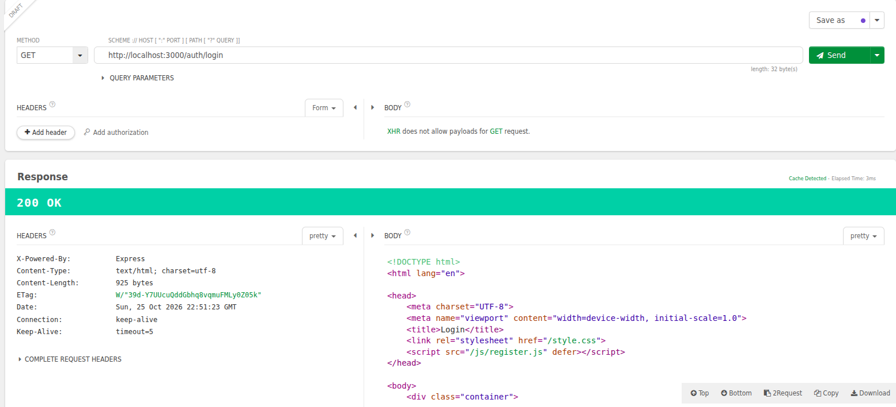
| POST | `/auth/login` | Valida les credencials i inicia sessió amb una cookie JWT. |
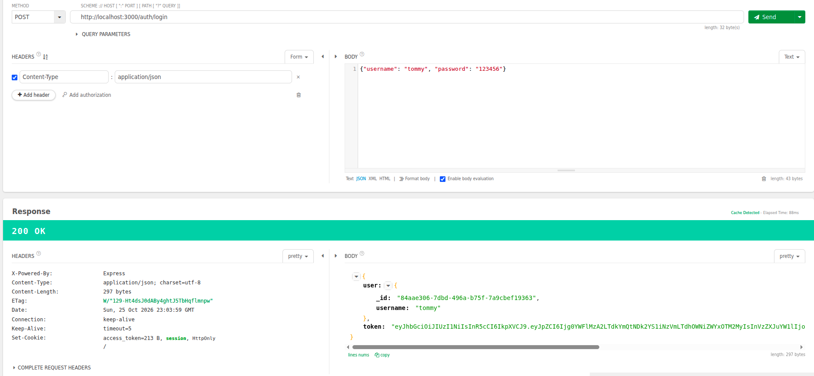
| GET | `/auth/register` | Mostra el formulari de registre. |
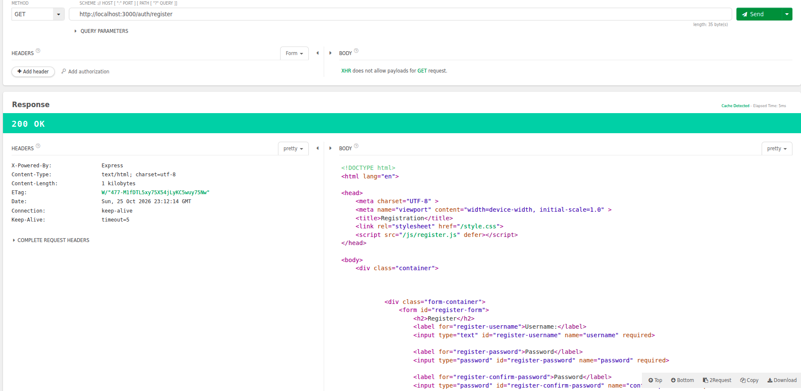
| POST | `/auth/register` | Crea el compte i inicia sessió amb una cookie JWT. |
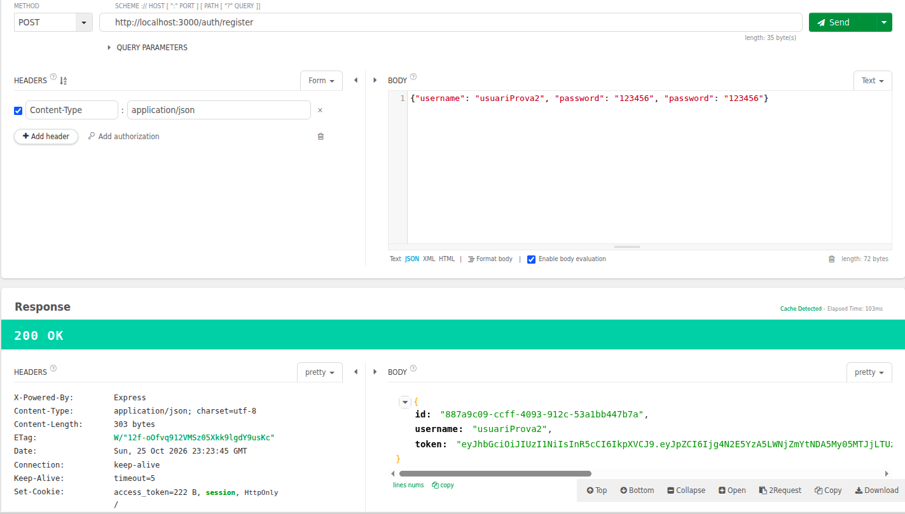
| GET | `/auth/protected` | Mostra el panell d'administració si hi ha una sessió vàlida. |
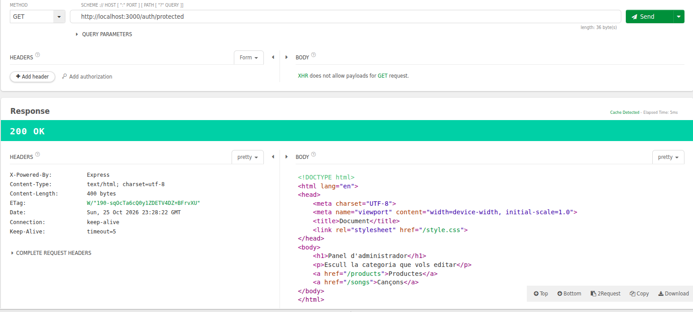
| POST | `/auth/logout` | Tanca la sessió eliminant la cookie JWT. |
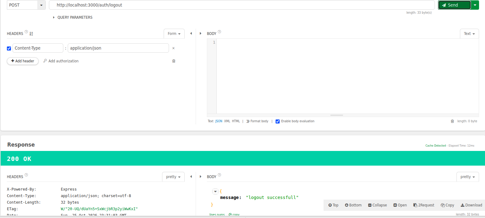

### Productes i cançons

Les rutes següents requereixen una sessió vàlida. Els canvis es desen a `db/db.json`.

| Mètode | Endpoint | Funcionament |
|---|---|---|
| GET | `/products` | Mostra el llistat de productes. |
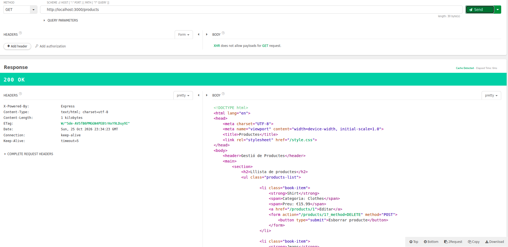
| GET | `/products/create_product` | Mostra el formulari per crear un producte. |
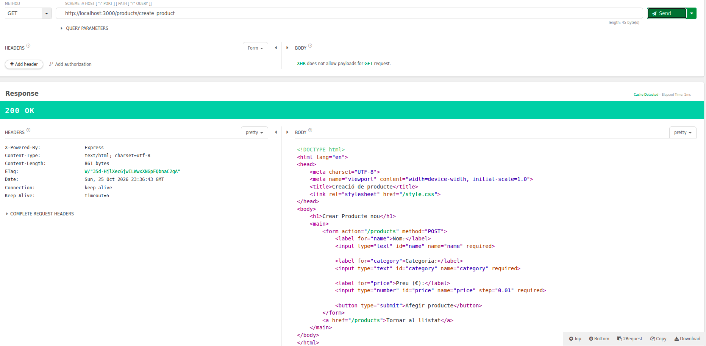
| GET | `/products/:id` | Mostra el formulari per editar un producte. |
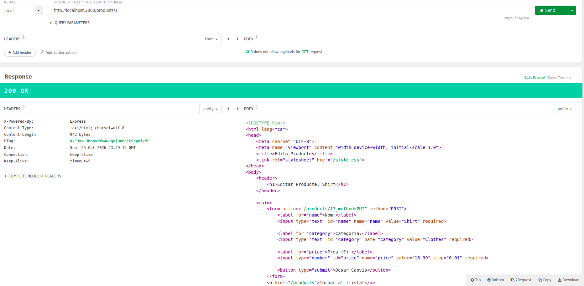
| POST | `/products` | Crea un producte. |
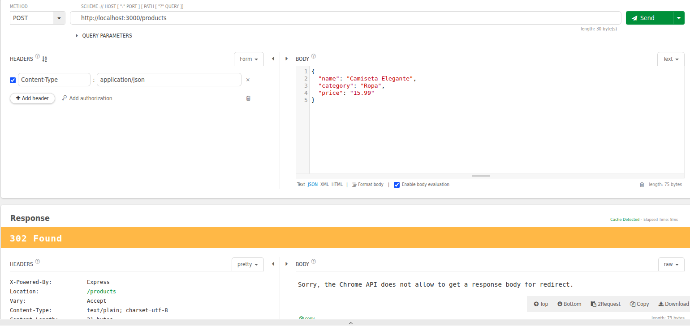
| PUT | `/products/:id` | Actualitza un producte. |
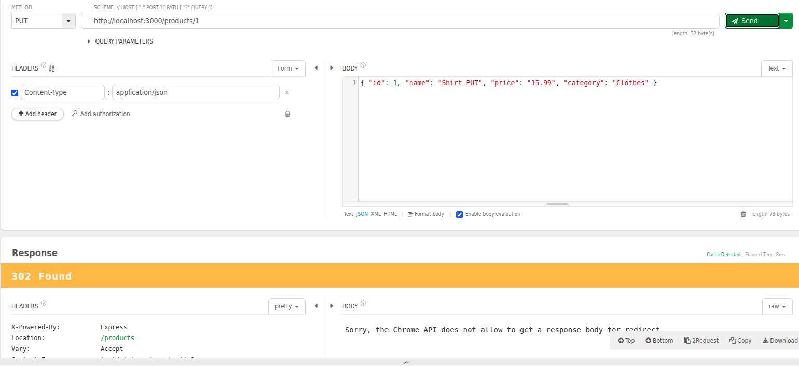
| DELETE | `/products/:id` | Elimina un producte. |
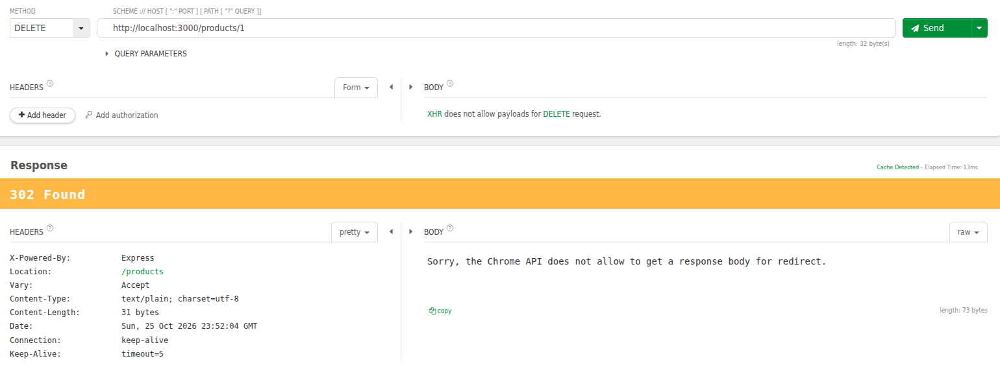
| GET | `/songs` | Mostra el llistat de cançons. |
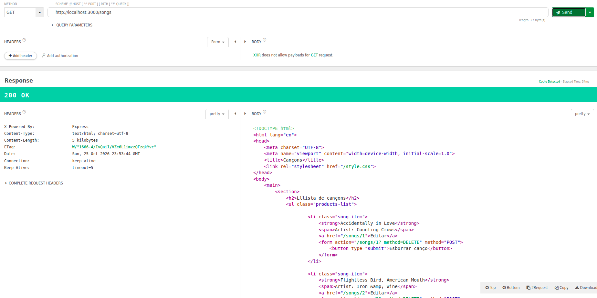
| GET | `/songs/create_song` | Mostra el formulari per crear una cançó. |
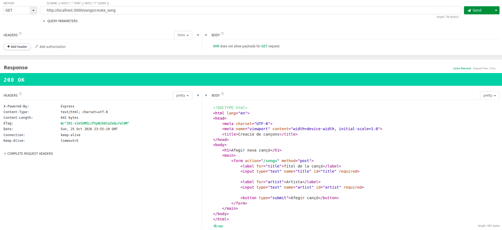
| GET | `/songs/:id` | Mostra el formulari per editar una cançó. |
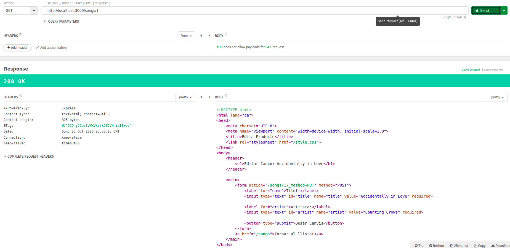
| POST | `/songs` | Crea una cançó. |
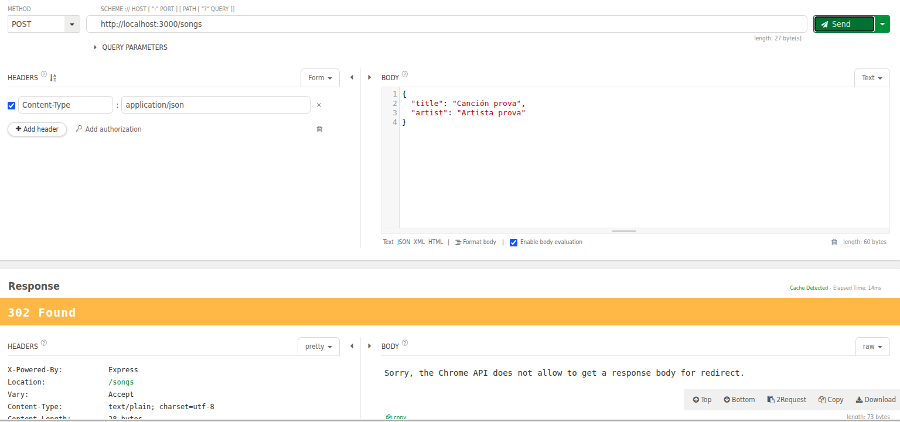
| PUT | `/songs/:id` | Actualitza una cançó. |
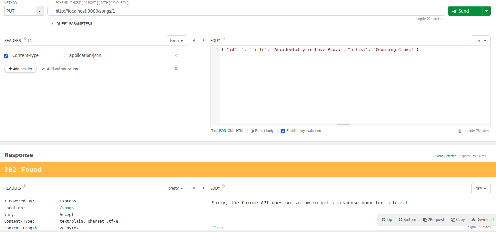
| DELETE | `/songs/:id` | Elimina una cançó. |
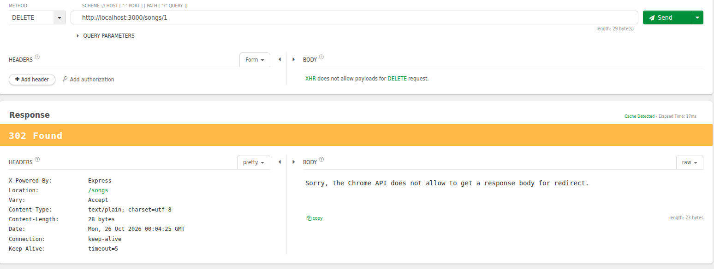